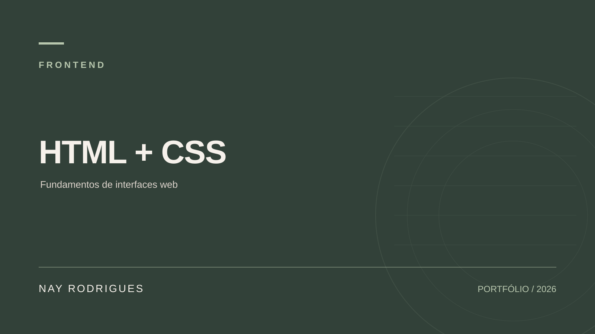

# Estudos de HTML e CSS

Exercícios e experiências de construção de páginas e estilos para interfaces web

**Estudo de frontend**

## Sobre

Este repositório reúne o material existente deste projeto e sua evolução técnica, as funcionalidades devem ser verificadas no código disponível

## Código

Consulte os arquivos versionados para conhecer a implementação atual
